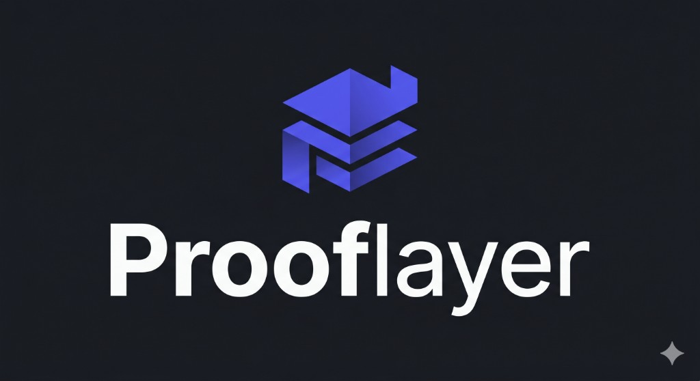

<p align="center">
  
</p>

<h1 align="center">Prooflayer</h1>

<p align="center">
  <strong>Turn your AI systems into evidence you can sell.</strong>
</p>

<p align="center">
  Prooflayer is a control plane that turns <strong>code + real AI usage</strong> into a structured model,
  <strong>deterministic policies</strong>, continuous evidence, and documents ready for sales and audit.
</p>

---

## Principles

- **AI proposes; rules decide.** LLMs suggest and enrich; compliance decisions and enforcement run through a **deterministic policy engine** (for example OPA/Rego), versioned and auditable.
- **Evidence by design.** Signals from repos, providers, and observability normalize into a single model, then flow through policies into an evidence graph and exportable docs.

## Pipeline (high level)

`Sources → Ingestion → Detection → Normalization → Policy Engine → Evidence Graph → Docs → UI/API`

## This repository

Landing and product UI built with **Next.js** (App Router), **React 19**, **Tailwind CSS**, and **Supabase** (e.g. waitlist). See [`CLAUDE.md`](./CLAUDE.md) for product blueprint, roadmap phases, and target backend stack.

## Getting started

Install dependencies and run the dev server:

```bash
pnpm install
pnpm dev
```

Open [http://localhost:3000](http://localhost:3000). Main entry: `app/page.tsx`.

```bash
pnpm build   # production build
pnpm start   # run production server locally
pnpm lint    # eslint
```

## Built with v0

This repo is linked to a [v0](https://v0.app) project. Merges to `main` deploy as configured for the project.

[Continue working on v0 →](https://v0.app/chat/projects/prj_fOUGtivlIj0kArVle2GuCY9DLhYG)

## Learn more

- [Next.js documentation](https://nextjs.org/docs)
- [v0 documentation](https://v0.app/docs)

<p align="center">
  <a href="https://v0.app/chat/api/kiro/clone/AntoineBejarano/prooflayer-app"></a>
</p>
